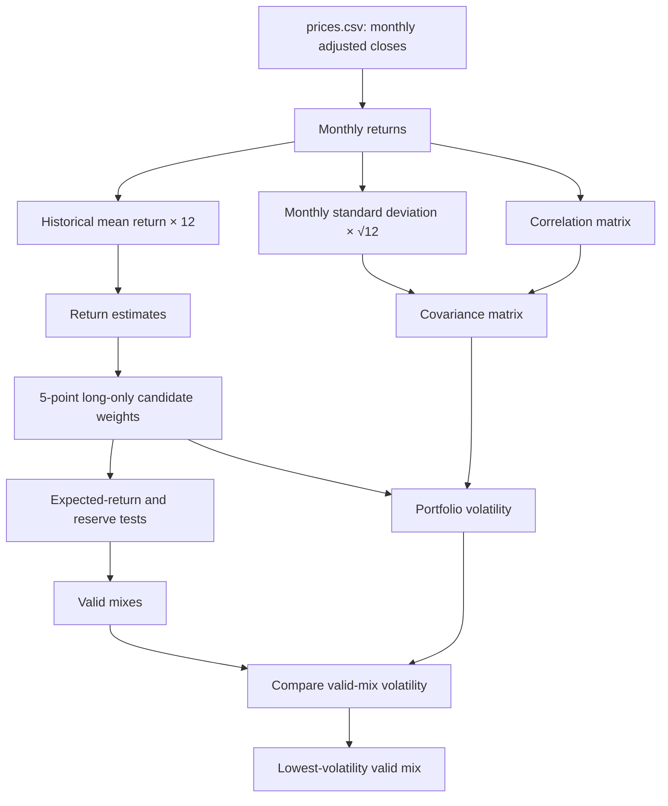

# My Portfolio Mandate and Price Data

## Objective and hard constraint

| Item | Choice |
|---|---|
| Objective | Earn a 6.5% annual expected return over a five-year horizon. |
| Hard constraint | Keep at least 3% of portfolio value in the cash-like Treasury sleeve (SGOV). |

## Fund universe

| Ticker | Fund | Role |
|---|---|---|
| SGOV | iShares 0–3 Month Treasury Bond ETF | Cash-like Treasury sleeve |
| BND | Vanguard Total Bond Market ETF | Broad U.S. fixed-income sleeve |
| VTI | Vanguard Total Stock Market ETF | U.S. equity sleeve |
| VXUS | Vanguard Total International Stock ETF | International equity sleeve |

## Portfolio-engine flow

## Historical-estimate app runs

These returns, volatilities, correlations, and portfolio results are historical estimates from the downloaded monthly prices, not forecasts.

| Run | Weights: VTI / VXUS / BND / SGOV | Expected return | Volatility | Reserve-eligible weight |
|---|---:|---:|---:|---:|
| All 59 monthly returns | 30% / 5% / 0% / 65% | 6.54% | 5.47% | 65% |
| Last 36 monthly returns | 5% / 10% / 0% / 85% | 6.75% | 1.74% | 85% |

Largest weight change between the two mixes: **25 percentage points** (VTI). The different answer shows that the selected historical window changes the estimates and the lowest-risk mix; it does not prove which period will repeat.

## Partner attack and response

**Partner attack:** The 12.0% historical VTI return estimate is the estimate I distrust most; lowering it to 8.0% changes the all-month answer to 10% VTI, 40% VXUS, 0% BND, and 50% SGOV, with 6.57% expected return and 7.50% volatility. **My answer:** The mix changes materially, so the historical VTI average is a load-bearing estimate rather than a forecast; I would monitor future equity-return assumptions and would not treat the original 30% VTI mix as certain.

## Project 2 starting-allocation call

**Pilot, not adopt:** Use the all-month 30% VTI / 5% VXUS / 0% BND / 65% SGOV mix only as the Project 2 starting allocation. Reoptimize before adopting it if the VTI return estimate is revised down to 8.0% or if the trailing-36-month evidence remains the more relevant regime, because those changes materially alter the weights and show that the optimizer amplifies estimate risk.

## `prices.csv` data record

`prices.csv` contains 60 monthly adjusted-close observations for each ticker, covering October 2021 through September 2026. The date column is Yahoo Finance's monthly interval timestamp; prices are in USD and are its `adjclose` field, rather than unadjusted close.

| Ticker | Source | Download date |
|---|---|---|
| SGOV | [Yahoo Finance chart data](https://query2.finance.yahoo.com/v8/finance/chart/SGOV?period1=1633046400&amp;period2=1790812800&amp;interval=1mo&amp;events=history&amp;includeAdjustedClose=true) | 2026-10-22 |
| BND | [Yahoo Finance chart data](https://query2.finance.yahoo.com/v8/finance/chart/BND?period1=1633046400&amp;period2=1790812800&amp;interval=1mo&amp;events=history&amp;includeAdjustedClose=true) | 2026-10-22 |
| VTI | [Yahoo Finance chart data](https://query2.finance.yahoo.com/v8/finance/chart/VTI?period1=1633046400&amp;period2=1790812800&amp;interval=1mo&amp;events=history&amp;includeAdjustedClose=true) | 2026-10-22 |
| VXUS | [Yahoo Finance chart data](https://query2.finance.yahoo.com/v8/finance/chart/VXUS?period1=1633046400&amp;period2=1790812800&amp;interval=1mo&amp;events=history&amp;includeAdjustedClose=true) | 2026-10-22 |
